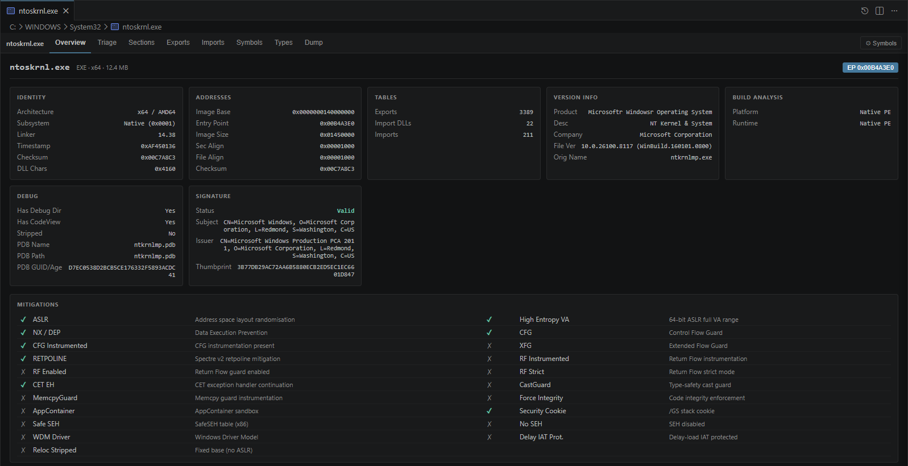
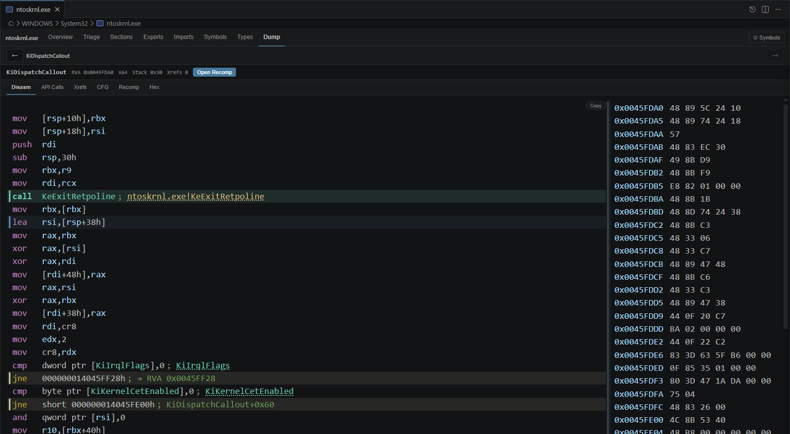
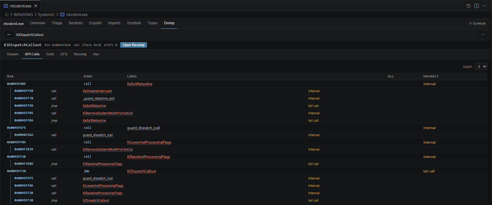
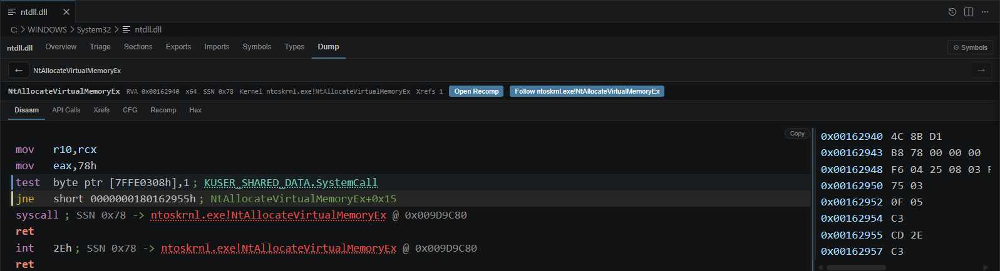
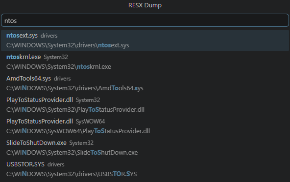
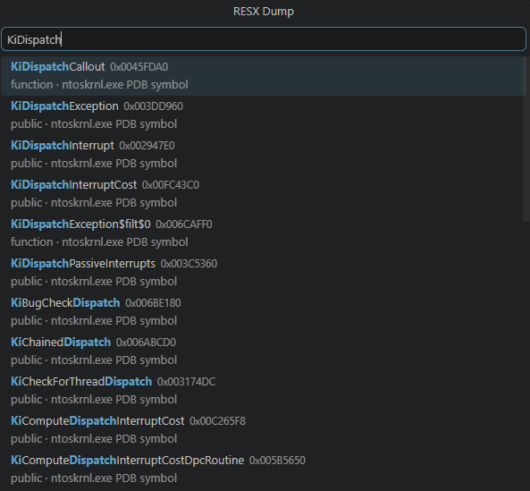
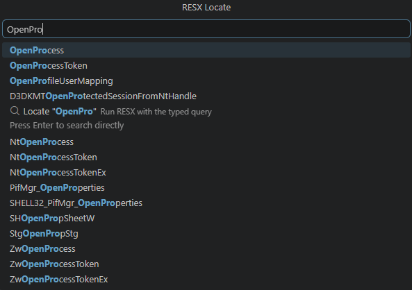

<h1 align="center">RESX</h1>
<p align="center"><b>Windows Binary Analysis & Reverse Engineering Toolkit</b></p>

<p align="center">
  
  
  
</p>

**RESX** is a specialized Windows SRE and Binary Analysis tool designed to provide a more modern approach to
reverse-engineer's & malware analyst's workflows. RESX is specially designed to provide in-depth information about the
binary you are analyzing, whether that is via triaging the process's capabilities, identifiying a packer, following
API calls through a large function tree, or even reverse-engineering a kernel driver, RESX provides an extended suite
of information that is aware of what API's do and which can be for what (eg; malware), driver-constructs,
hypervisor-capabilities, and some shortcomings of mainstream disassembly tools.

<details>
<summary><h2 style="display: inline;">Showcase &amp; Examples</h2></summary>

<details>
<summary><h3 style="display: inline;">Binary Triage & API Call Graphs</h3></summary>

Let's say I want to quickly figure out what this binary is doing we can invoke the calls command to get a
call-graph on the Windows API's it invokes *(or any other .dll, CRT, or internal functions if you have PDB)*. This can very quickly give us a basis and structured indicators on where
to look next, depending on the program this can also reveal a significant amount of functionality without even opening
a disassembler;

```powershell
> resx /calls "SAMPLE.exe" ENTRY --depth 4 --only winapi --no-pdb --time
SAMPLE.exe!entry  [RVA 0x000023E0, VA 0x1400023E0]

API Call Map for entry  [2 of 2 call site(s) · filter: winapi]:
  ├── 0x23E4  CALL  sub_00002770
  │   ├── 0x279E  CALL  KERNEL32!GetSystemTimeAsFileTime
  │   ├── 0x27AE  CALL  KERNEL32!GetCurrentThreadId
  │   ├── 0x27BB  CALL  KERNEL32!GetCurrentProcessId
  │   └── 0x27CD  CALL  KERNEL32!QueryPerformanceCounter
  └── 0x23ED  JMP  sub_00002260 [tail call]
      ├── 0x236A  CALL  sub_000019E0
      │   ├── 0x1A23  CALL  KERNEL32!InitializeSRWLock
      │   ├── 0x1A2E  CALL  KERNEL32!InitializeConditionVariable
      │   ├── 0x1A39  CALL  sub_00001160
      │   │   ├── 0x1179  CALL  KERNEL32!CreateWaitableTimerExW
      │   │   └── 0x11B6  CALL  KERNEL32!SetWaitableTimer
      │   ├── 0x1A47  CALL  sub_000015B0
      │   │   ├── 0x15D0  CALL  KERNEL32!VirtualAlloc
      │   │   ├── 0x15F2  CALL  KERNEL32!VirtualAlloc
      │   │   └── 0x1608  CALL  KERNEL32!VirtualFree
      │   ├── 0x1A55  CALL  sub_00001630
      │   │   ├── 0x165C  CALL  KERNEL32!CreateThread
      │   │   ├── 0x1672  CALL  KERNEL32!AcquireSRWLockExclusive
      │   │   ├── 0x167F  CALL  KERNEL32!ReleaseSRWLockExclusive
      │   │   ├── 0x1689  CALL  KERNEL32!WakeConditionVariable
      │   │   ├── 0x1697  CALL  KERNEL32!WaitForSingleObject
      │   │   └── 0x16A2  CALL  KERNEL32!CloseHandle
      │   ├── 0x1A63  CALL  sub_00001770
      │   │   ├── 0x1795  CALL  KERNEL32!VirtualProtect
      │   │   └── 0x17C4  CALL  KERNEL32!VirtualProtect
      │   ├── 0x1A71  CALL  sub_000017F0
      │   │   ├── 0x1820  CALL  KERNEL32!CreateFileMappingW
      │   │   ├── 0x185A  CALL  KERNEL32!MapViewOfFile
      │   │   ├── 0x1884  CALL  KERNEL32!FlushViewOfFile
      │   │   ├── 0x18A9  CALL  KERNEL32!UnmapViewOfFile
      │   │   └── 0x18B2  CALL  KERNEL32!CloseHandle
      │   ├── 0x1A7F  CALL  sub_000013A0
      │   │   ├── 0x13BF  CALL  bcrypt!BCryptGenRandom
      │   │   ├── 0x13E7  CALL  bcrypt!BCryptOpenAlgorithmProvider
      │   │   ├── 0x142D  CALL  bcrypt!BCryptCreateHash
      │   │   ├── 0x1478  CALL  bcrypt!BCryptFinishHash
      │   │   ├── 0x1488  CALL  bcrypt!BCryptDestroyHash
      │   │   └── 0x1494  CALL  bcrypt!BCryptCloseAlgorithmProvider
      │   ├── 0x1A8D  CALL  sub_00001920
      │   │   ├── 0x1936  CALL  KERNEL32!WaitForSingleObject
      │   │   └── 0x1945  CALL  KERNEL32!CancelWaitableTimer
      │   ├── 0x1AA4  CALL  KERNEL32!GetLastError
      │   └── 0x1AD3  CALL  sub_000018D0
      │       ├── 0x18EA  CALL  KERNEL32!VirtualFree
      │       └── 0x1901  CALL  KERNEL32!CloseHandle
      ├── 0x2371  CALL  sub_00002910
      │   └── 0x2916  CALL  KERNEL32!GetModuleHandleW
      └── 0x2393  CALL  sub_00002910 [expanded above]
RESX: completed in 10ms
```

With one command, we've mapped out a significant amount of the program's functionality:

- **`VirtualAlloc`, `VirtualFree`, `VirtualProtect`**: Dynamic memory allocation and protection manipulation.
- **`CreateThread`, `WaitForSingleObject`, `SRWLock`**: Multithreaded execution and synchronization.
- **`CreateWaitableTimerExW`, `SetWaitableTimer`**: Scheduled or delayed execution.
- **`CreateFileMappingW`, `MapViewOfFile`**: Memory-mapped files or shared memory.
- **`BCryptGenRandom`, `BCryptCreateHash`**: Cryptographic randomness and hashing.
- **`QueryPerformanceCounter`, `GetSystemTimeAsFileTime`**: High-resolution timing and timestamps.
- **`GetCurrentProcessId`, `GetCurrentThreadId`, `GetModuleHandleW`**: Process, thread, and module introspection.

From this alone, we can infer that the binary performs **memory management, concurrent execution, cryptographic operations, and memory-mapped I/O**. The combination of memory protection changes and thread creation may warrant further investigation, particularly when analyzing packers, instrumentation frameworks, or malware.

</details>

<details>
<summary><h3 style="display: inline;">API-Aware Static Analysis</h3></summary>

RESX goes beyond identifying API calls. With Windows SDK integration, it can recover official parameter names, resolve Windows constants, identify function pointers, and reconstruct arguments directly from machine code, even without PDB symbols.

For example, using `--args`:

```powershell
> resx /calls "SAMPLE.exe" ENTRY --depth 5 --only winapi --no-pdb --args
```

```powershell
├── 0x15D0  CALL  KERNEL32!VirtualAlloc
│   └── args
│       ├── lpAddress        = NULL
│       ├── dwSize           = 0x10000
│       ├── flAllocationType = MEM_RESERVE
│       └── flProtect        = PAGE_NOACCESS
│
├── 0x165C  CALL  KERNEL32!CreateThread
│   └── args
│       ├── lpThreadAttributes = NULL
│       ├── dwStackSize        = 0
│       ├── lpStartAddress     = &fn_0x000016E0
│       ├── lpParameter        = arg1
│       ├── dwCreationFlags    = 0
│       └── lpThreadId         = NULL
│
├── 0x13BF  CALL  bcrypt!BCryptGenRandom
│   └── args
│       ├── hAlgorithm = NULL
│       ├── pbBuffer   = ?
│       ├── cbBuffer   = 0x10
│       └── dwFlags    = BCRYPT_USE_SYSTEM_PREFERRED_RNG
│
└── 0x13E7  CALL  bcrypt!BCryptOpenAlgorithmProvider
    └── args
        ├── phAlgorithm       = &local_10
        ├── pszAlgId          = L"SHA256"
        ├── pszImplementation = NULL
        └── dwFlags           = 0
```

From these calls alone, we can infer that the binary **reserves 64 KiB of virtual address space, creates a thread at a recovered function entry point, requests 16 bytes of cryptographically secure random data, and initializes a SHA-256 hashing provider**.

</details>

<details>
<summary><h3 style="display: inline;">Dynamic API Resolution &amp; Deobfuscation</h3></summary>

RESX can statically recover dynamically resolved Windows APIs, including those hidden behind **API hashing, PEB loader-list traversal, manual export-table parsing, and encoded API names**. This allows analysts to identify functionality that may be absent from a binary's conventional import table, without manually reversing the resolution routines.

**API hashing & manual export resolution**

```powershell
> resx /calls "HASHED.exe" rva:0x1770 --depth 3 --only dynamic --no-pdb
```

```powershell
├── 0x1779  CALL  sub_00001000
│   ├── 0x101F  CALL  sub_00001230
│   │   resolves: kernel32!VirtualAlloc (export-table walk · ror13-add hash 0x91AFCA54 · loader-list walk, djb2 hash 0x7040EE75)
│   ├── 0x102F  CALL  sub_00001230
│   │   resolves: kernel32!VirtualFree (export-table walk · ror13-add hash 0x30633AC · loader-list walk, djb2 hash 0x7040EE75)
│   ├── 0x1054  CALL  kernel32!VirtualAlloc [dynamic · export-table walk]
│   └── 0x1066  CALL  kernel32!VirtualFree [dynamic · export-table walk]
```


**Encoded API name recovery**

```powershell
> resx /calls "ENCODED.exe" rva:0x16B0 --depth 3 --only dynamic --no-pdb
```

```powershell
├── 0x16E0  CALL  sub_000010C0
│   ├── 0x1113  CALL  KERNEL32!GetProcAddress
│   │   resolves: kernel32!CreateThread (GetProcAddress · xor 0x5A)
│   └── 0x113B  CALL  kernel32!CreateThread [dynamic · GetProcAddress · xor 0x5A]
├── 0x16EC  CALL  sub_00001510
│   ├── 0x1629  CALL  KERNEL32!GetProcAddress
│   │   resolves: kernel32!VirtualProtect (GetProcAddress · rolling xor 0x31+i)
│   └── 0x1652  CALL  kernel32!VirtualProtect [dynamic · GetProcAddress · rolling xor 0x31+i]
```


RESX identifies the underlying Windows APIs and their resolution mechanisms, turning otherwise opaque indirect calls into actionable call-graph evidence. Both examples are recovered statically without PDB symbols.

</details>

<details>
<summary><h3 style="display: inline;">Windows Internals, Syscalls &amp; Function Disassembly</h3></summary>

RESX can also help with Windows internals. Let's locate VirtualAlloc and follow it into the kernel.

```powershell
>  resx /locate VirtualAlloc

Locations of 'VirtualAlloc':
  C:\WINDOWS\System32\KernelBase.dll  KernelBase.dll!VirtualAlloc  ord:1909  RVA:0x000B6650
  C:\WINDOWS\System32\kernel32.dll  kernel32.dll!VirtualAlloc  ord:1563  RVA:0x00033160  →
api-ms-win-core-memory-l1-1-0.dll!VirtualAlloc  [stub]
```

It doesn't stop at the userland boundary, either. Ask what `VirtualAlloc` actually does and it follows the call
through the `ntdll` syscall stub into the kernel routine that services it, in one tree:

```powershell
>  resx /calls KernelBase.dll VirtualAlloc --depth 2

KernelBase.dll!VirtualAlloc  [RVA 0x000B6650, VA 0x1800B6650]

API Call Map for VirtualAlloc  [3 call site(s)]:
  ├── 0xB668D  CALL  ntdll!NtAllocateVirtualMemory [syscall]
  │   kernel: ntoskrnl!NtAllocateVirtualMemory
  │   ├── 0x882EAE  CALL  MiAllocateVirtualMemoryPrepare
  │   ├── 0x882EFA  CALL  MiAllocateVirtualMemory
  │   ├── 0x882F49  CALL  ObfDereferenceObjectWithTag
  │   └── 0x882FE6  CALL  PsDereferencePartition
  ├── 0xB66AD  CALL  ntdll!RtlSetLastWin32Error
  └── 0xB66BF  CALL  BaseSetLastNTError
      ├── 0x22E56  CALL  ntdll!RtlNtStatusToDosError
      └── 0x22E66  CALL  ntdll!RtlSetLastWin32Error
```

And of course, you can dump functions aswell:

```powershell
>  resx /dump ntdll.dll NtAllocateVirtualMemory --cfg text

ntdll.dll!NtAllocateVirtualMemory  [RVA 0x00162040, VA 0x180162040]
  Base0/RVA: 0x00162040  |  VA: 0x180162040
  Signature [static-abi-inference]: unknown NtAllocateVirtualMemory(int64_t arg1, /* further arguments unknown */)
  00162040  mov        r10, rcx
  00162043  mov        eax, 0x18  ; syscall 0x18 (24)
  00162048  test       byte ptr [0x7ffe0308], 1  ; KUSER_SHARED_DATA.SystemCall
  00162050  jne        short 0x180162055  ; → loc_00162055
  00162052  syscall
  00162054  ret
  00162055  int        0x2e
  00162057  ret

Control Flow Graph:
  blocks:  3
  entry :  block_00162040

block_00162040  [entry]:  [4 insn]  range 0x00162040..0x00162050
    0x00162040  4C 8B D1                    mov        r10, rcx
    0x00162043  B8 18 00 00 00              mov        eax, 0x18  ; syscall 0x18 (24)
    0x00162048  F6 04 25 08 03 FE 7F 01     test       byte ptr [0x7ffe0308], 1  ; KUSER_SHARED_DATA.SystemCall
    0x00162050  75 03                       jne        short 0x180162055  ; → loc_00162055
    edges:
      [taken] jne -> block_00162055 (→ loc_00162055)
      [fallthrough] fallthrough -> block_00162052

block_00162052  [exit]:  [2 insn]  range 0x00162052..0x00162054
    0x00162052  0F 05                       syscall
    0x00162054  C3                          ret
    edges:
      [exit] return
```

That same kernel awareness drives RESX's driver analysis: dispatch routines, IOCTL codes, and VMX/SVM hypervisor primitives (`resx driver`, `resx ioctl`).

</details>

<details>
<summary><h3 style="display: inline;">IOCTL &amp; Kernel Driver Analysis</h3></summary>

RESX can statically reconstruct Windows driver communication interfaces from both **user-mode clients and kernel-mode drivers**, recovering IOCTL codes, request arguments, dispatch routines, buffer requirements, and validation logic without executing the binaries.

**User-mode: Reconstructing driver requests**

```powershell
> resx /ioctl client.dll --args
```

```powershell
IOCTL and NDIS recovery
Image:  client.dll
Result:  28 IOCTL code evidence record(s), 0 registered dispatch root(s)

Code          Function   Access  Method    Input B  Output B
0x8337A004    0x801      W       BUFFERED  8        0
0x8337600C    0x803      R       BUFFERED  0        1496
0x83376058    0x816      R       BUFFERED  0        ((min_u32(arg2, 64) * 1496) + 16)
```

RESX can also reconstruct the underlying `DeviceIoControl` arguments, including dynamically calculated buffer sizes:

```c
BkscGetEvents -> DeviceIoControl
call RVA 0x00003E15  IOCTL 0x83376058

DeviceIoControl(
    arg0,                               // handle
    0x83376058,                         // ioctl
    NULL,                               // input_buffer
    0,                                  // input_length
    calloc_result,                      // output_buffer
    ((min_u32(arg2, 64) * 1496) + 16),  // output_length
    &frame_minus_0x48,                  // bytes_returned
    NULL                                // overlapped
);
```


**Kernel-mode: Recovering dispatch routines and validation**

For example, analyzing Microsoft's DirectX graphics kernel driver:

```powershell
> resx /ioctl dxgkrnl.sys
```

```text
IOCTL and NDIS recovery
Image:  dxgkrnl.sys
Result:  14 IOCTL code evidence record(s), 2 registered dispatch root(s)

Dispatch RVA    Codes  Registration evidence
0x00074A50      1      IRP_MJ_DEVICE_CONTROL assignment at 0x00452519
0x003E5660      13     IRP_MJ_INTERNAL_DEVICE_CONTROL assignment at 0x00452527
```

RESX can further recover request buffer checks and trace their associated failure paths:

```text
Code        Buffer  Guard    Check RVA   Failure status  Failure RVA
0x00234003  input   == 16    0x00074B42  0xC0000206      0x00074FBF
0x00234003  output  == 8     0x00074B6B  0xC0000206      0x00074FBF
0x0023E057  input   >= 832   0x003E587E 0xC0000206      0x003E5740
```


This gives analysts a starting point for **reverse-engineering undocumented driver protocols and auditing kernel request handlers**, without manually tracing every `DeviceIoControl` invocation, dispatch-table assignment, or buffer-length comparison.


</details>

<details>
<summary><h3 style="display: inline;">Startup Flow &amp; Thread Callback Recovery</h3></summary>

Finding a `CreateThread` call is useful, but what does the thread actually do? RESX can follow a statically recovered callback into the same image and show the code behind it, instead of leaving us with just a function pointer.

Using the same sample from the API-argument example:

```powershell
resx reconstruct-cfg "SAMPLE.exe" --thread-filter spawned --depth 5 --max-total 800 --no-pdb --no-color
```

```text
Root 1/3: PE Entry Point sub_000023E0 0x000023E0 PE Entry Point [.text] <synthetic, bound .pdata 0x000023E0..0x000023F2> (AddressOfEntryPoint; declared executable entry point; transfer and execution unobserved)
`-- 0x000023ED jmp -> sub_00002260 0x00002260 [tail-jump, unknown]
    `-- 0x0000236A call -> sub_000019E0 0x000019E0 [unknown]
        `-- 0x00001A55 call -> sub_00001630 0x00001630 [unknown]
            `-- 0x0000165C call -> KERNEL32.dll!CreateThread [import, indirect, thread-spawn, microsoft-api] ; IAT [rip+0x1400030A8]; thread-start callback arg3 via r8 loaded address
                `-- thread-start -> sub_000016E0 0x000016E0 Thread Start [.text] <synthetic, bound .pdata 0x000016E0..0x000016F5, thread lane 1> (KERNEL32.dll!CreateThread @ 0x0000165C; callback recovered from KERNEL32.dll!CreateThread)
                    |-- 0x000016E9 call -> KERNEL32.dll!AcquireSRWLockExclusive [import, indirect, microsoft-api] ; IAT [rip+0x140003068]
                    |-- 0x00001710 call -> KERNEL32.dll!SleepConditionVariableSRW [import, indirect, microsoft-api] ; IAT [rip+0x140003080]
                    |-- 0x0000173E call -> sub_000011D0 0x000011D0 [unknown]
                    |   `-- truncated: max depth 5 [0x000011D0]
                    `-- 0x00001753 call -> KERNEL32.dll!ReleaseSRWLockExclusive [import, indirect, microsoft-api] ; IAT [rip+0x140003060]
```

Here we can follow the path from the executable's entry point to `CreateThread`, then into the worker at `0x16E0`. Inside that worker, RESX identifies `AcquireSRWLockExclusive`, `SleepConditionVariableSRW`, and `ReleaseSRWLockExclusive`, giving us a starting point for investigating how the thread waits on and accesses shared state.

</details>

<details>
<summary><h3 style="display: inline;">Comparing Builds &amp; Hunting Related Binaries</h3></summary>

Let's say we have two versions of a DLL and want to figure out where to look first. Comparing raw bytes can get noisy when addresses or layouts move around, so RESX can compare normalized function code, control-flow structure, API calls, and other properties instead.

```powershell
resx diff "sample.dll" "sample-v2.dll" --max-functions 200 --no-pdb --no-color
```

```text
Similarity :   90
Unique     :   87  (180 noisy matches filtered)
Coverage   :  left 97% / right 97%
Functions  :  194 matched  |  193 exact  1 strong  0 changed  0 weak
Unmatched  :  6 left-only  |  6 right-only

Changed Clusters
  left-only .text 0x00001040..0x0000135D  funcs:5  avg:-
    ResxBehaviorSignals
    ResxDeviceIoctlDispatch
    ResxParsePacket
  left-only .text 0x000073A0..0x000074C1  funcs:1  avg:-
    sub_000073A0
  right-only .text 0x00001020..0x000013EB  funcs:6  avg:-
    ResxBehaviorSignals
    ResxDeviceIoctlDispatch
    ResxParsePacket
```

In this comparison, most of the profiled functions match, while several application exports appear in unmatched clusters. That gives us a much smaller set of functions to inspect, rather than starting from scratch in both binaries.

We can also save a reusable index and compare another binary against it:

```powershell
resx index "sample.dll" --db samples.resxdb --max-functions 200 --no-pdb --no-color --quiet
resx hunt "sample-v2.dll" --db samples.resxdb --max-functions 200 --no-pdb --no-color --quiet
```

```text
1. [ 96] sample.dll  sample.dll
   unique  95 | metadata 98 | coverage left 100% / right 99% | matches 198
   tags: shared-codebase, shared-exports, variant-build
   [ 86] strong ResxIndirectCallMessage -> ResxIndirectCallMessage
   [ 73] changed ResxDeviceIoctlDispatch -> ResxDeviceIoctlDispatch
   [ 69] changed ResxParsePacket -> ResxParsePacket
   [ 68] changed ResxSwitchJumpTableDispatch -> ResxSwitchJumpTableDispatch
   [ 66] changed ResxBehaviorSignals -> ResxBehaviorSignals
```

This small demo indexes one reference DLL. The same `index` command also accepts a directory, so we can build a corpus and look for related code across a collection of binaries. The hunt output highlights related code and the functions worth comparing next.

These examples profile 200 functions per image. Increase `--max-functions` when you want to cover more of a larger binary.

</details>

<details>
<summary><h3 style="display: inline;">PowerShell Automation &amp; JSON Analysis</h3></summary>

RESX isn't limited to reading a report in the terminal. We can take its JSON output and use it directly in PowerShell, Python, or another tool, which lets us ask more specific questions about the binary.

For example, let's pull out the recovered `VirtualAlloc` and `VirtualProtect` protection arguments and check whether they request executable memory. This example uses the configured Windows SDK headers and `--args`:

```powershell
$json = resx behavior "SAMPLE.exe" --args --json --no-pdb --quiet
if ($LASTEXITCODE -ne 0) { throw "RESX analysis failed" }
$report = $json | ConvertFrom-Json

$rows = foreach ($site in $report.behavior.api_signatures.PSObject.Properties) {
    $sig = $site.Value
    if ($sig.call -notmatch '^Virtual(Alloc|Protect)\(') { continue }

    $slot = if ($sig.call.StartsWith('VirtualAlloc(')) { 3 } else { 2 }
    $arg = $sig.arguments[$slot]
    [pscustomobject]@{
        RVA        = '0x{0:X8}' -f [uint32]$site.Name
        API        = ($sig.call -split '\(', 2)[0]
        Protection = if ($arg.kind -eq 'int') {
            '0x{0:X}' -f [uint64]$arg.value
        } else { 'unknown' }
        Executable = if ($arg.kind -eq 'int') {
            (([uint64]$arg.value -band 0xF0) -ne 0)
        } else { 'unknown' }
    }
}
$rows | Format-Table -AutoSize
```

```text
RVA        API            Protection Executable
---        ---            ---------- ----------
0x000015D0 VirtualAlloc   0x1             False
0x000015F2 VirtualAlloc   0x4             False
0x00001795 VirtualProtect 0x2             False
0x000017C4 VirtualProtect unknown       unknown
```

Here we have `PAGE_NOACCESS`, `PAGE_READWRITE`, and `PAGE_READONLY`, with the final protection argument reported as `unknown`.

Because `$rows` contains PowerShell objects, we can filter or export the results without scraping coloured terminal output:

```powershell
$rows | Where-Object { $_.Executable -eq $true }
$rows | Export-Csv .\memory-protections.csv -NoTypeInformation
```

The executable-memory filter returns no rows for this sample. We can extend the script with more APIs, run it across a directory of binaries, or feed the resulting addresses straight into another RESX command.

</details>

<details>
<summary><h3 style="display: inline;">PE Structure, Section Permissions &amp; Validation</h3></summary>

Before diving into individual functions, we can also check how the image is laid out. Section permissions, entropy, and structural checks give us another way to decide what needs a closer look.

```powershell
resx sections "sample.dll" --no-pdb --no-color --quiet
```

```text
Sections:
┌────────────────┬──────────────────┬──────────────────┬──────────────────┬────────────┬────────────────┬──────────────┐
│ Name           │ RVA              │ VSize            │ Raw              │ Prot       │ Expected       │ Entropy      │
├────────────────┼──────────────────┼──────────────────┼──────────────────┼────────────┼────────────────┼──────────────┤
│ .text          │ 0x00001000       │ 0x0000D330       │ 0x0000D400       │ RX         │ RX             │ 6.408        │
│ .rdata         │ 0x0000F000       │ 0x00009B62       │ 0x00009C00       │ R          │ R              │ 4.708        │
│ .data          │ 0x00019000       │ 0x000015B8       │ 0x00000C00       │ RW         │ RW             │ 1.902        │
│ .pdata         │ 0x0001B000       │ 0x00001050       │ 0x00001200       │ R          │ R              │ 4.561        │
│ .text          │ 0x0001D000       │ 0x0000000B       │ 0x00000200       │ RX         │ RX             │ 0.183        │
│ .fptable       │ 0x0001E000       │ 0x00000100       │ 0x00000200       │ RW         │ Varies         │ 0.000        │
│ .reloc         │ 0x0001F000       │ 0x00000654       │ 0x00000800       │ R          │ R              │ 4.849        │
└────────────────┴──────────────────┴──────────────────┴──────────────────┴────────────┴────────────────┴──────────────┘
```

This gives us each section's address, size, permissions, and entropy in one view. We can see executable code in the `RX` sections and writable data in the `RW` sections, without manually decoding PE section flags.

For structural validation:

```powershell
resx pechk "sample.dll" --no-pdb --no-color
```

```text
Findings: 0
  ✓ no structural PE anomalies
```

This fixture passes the structural checks. Between the section layout, permissions, and call-graph evidence, we can quickly decide where to spend our time before opening a full disassembler.

</details>

<details>
<summary><h3 style="display: inline;">Live Analysis with SKUGGA</h3></summary>

RESX also works in conjunction with another one of my tools, ***[SKUGGA](https://github.com/Ryftenius/SKUGGA/)***, which is a lightweight process instrumentation framework. We can use RESX to find an interesting call, then run the same binary under SKUGGA to see its arguments, result, and call stack live.

Let's take `DYNAMIC.exe`. It resolves `VirtualAlloc` through `GetProcAddress`, so we start by asking RESX what that indirect call is doing:

```powershell
resx /calls "DYNAMIC.exe" rva:0x1100 --depth 1 --only kernel32 --args --no-pdb --no-color
```

```powershell
  ├── 0x1160  CALL  kernel32!VirtualAlloc [dynamic · GetProcAddress]
  │   └── args
  │       ├── lpAddress        = NULL
  │       ├── dwSize           = 0x1000
  │       ├── flAllocationType = MEM_COMMIT|MEM_RESERVE
  │       └── flProtect        = PAGE_READWRITE
```

RESX identifies a 4 KiB allocation with `MEM_COMMIT|MEM_RESERVE` and `PAGE_READWRITE` at RVA `0x1160`. Now we run it under SKUGGA, selecting the native allocation and free APIs and enabling call stacks:

```powershell
sk run "DYNAMIC.exe" --api NtAllocateVirtualMemory,NtFreeVirtualMemory --stack --timeout 10s
```

```powershell
[skugga] NtAllocateVirtualMemory hit status=0x00000000 target=self(pid=44368 name=DYNAMIC.exe) addr=0x1C97CE20000 size=0x1000 pages=1 alloc=COMMIT|RESERVE protect=RW vad=MEM_PRIVATE/UNKNOWN region=0x1C97CE20000-0x1C97CE2E000 region_size=56.00KB caller=KERNELBASE.dll+0xB6694
    #00 [system]   KERNELBASE.dll+0xB6694
    #01 [app]      DYNAMIC.exe+0x1166
    #02 [app]      DYNAMIC.exe+0x1301
    #03 [app]      DYNAMIC.exe+0x17FF
    #04 [system]   KERNEL32.DLL+0x2DDA7
    #05 [system]   ntdll.dll+0x7EE4C
```

There it is: `size=0x1000`, `alloc=COMMIT|RESERVE`, `protect=RW`, and a successful `status=0x00000000`. SKUGGA also gives us the allocated address and the path back through `KERNELBASE.dll` into our executable.

The application frame is `DYNAMIC.exe+0x1166`. We can line that up with the original call by dumping its instructions:

```powershell
resx /dump "DYNAMIC.exe" --at 0x1100 --bytes --max-insns 100 --no-pdb --no-color --quiet
```

```powershell
  00001160  ff 15 2a 20 00 00              call       qword ptr [0x140003190]
  00001166  48 85 c0                       test       rax, rax
```

The call at `0x1160` is six bytes long, so `0x1166` is the return address immediately after it, the same address shown in SKUGGA's live stack. We have gone from a dynamically resolved API, to its recovered arguments, to the matching live allocation and back to the exact machine-code call site.

</details>

</details>

## Documentation

- [Full changelog](CHANGELOG.md)
- [Command reference](COMMANDS.md)
- [CLI documentation](docs/cli.md)
- [VS Code extension documentation](docs/vscode-extension.md)
- [DLL / FFI integration](docs/dll.md)
- [Analysis surfaces](docs/analysis-surfaces.md)
- [JSON schemas](docs/json-schemas.md)
- [Security policy](SECURITY.md)

## Features

- Reachable multi-stream decoding for overlapping x86/x64 instruction streams.
- Bounded Win64 ABI prototype recovery for register, stack, integer, floating-point, pointer, and return-value evidence.
- Kernel-driver, WDF, NDIS, and hypervisor-oriented analysis with IOCTL and dispatch recovery.
- Static behavior triage for syscall stubs, anti-analysis instructions, TLS callbacks, loader APIs, executable-memory setup, IPC, networking, and cryptography.
- Reverse caller tracing across priority modules and custom scan scopes.
- Startup-flow reconstruction from entry points, TLS callbacks, thread and work-pool callbacks, import calls, indirect edges, and x64 unwind or exception-handler evidence.
- Structural diffing, CFG diff views, code and control heatmaps, corpus indexing, and sample hunting.
- Integrated VS Code binary viewer for navigation, triage, flow, symbols, types, scans, and function analysis.
- Protected-file triage for packer markers, OEP handoff candidates, import-rebuild leads, VM dispatcher or handler candidates, and bounded payload recovery.
- C-like reconstruction and bounded CFG rendering for selected functions.
- Hardened PE32+ metadata, section, data-directory, debug, CLR, TLS, load-configuration, certificate, version, and anomaly inspection.
- Export and PDB symbol loading, type browsing, and symbol-backed navigation.
- Targeted disassembly by name, RVA, VA, file offset, or ordinal.
- Incoming call and jump xrefs for functions and imports.
- Static triage with hook and thunk indicators, string references, API-call maps, suspicious control-flow hints, and explicit decode-conflict records.
- Hostile-mode tracing for packed or deliberately confusing binaries.
- Guarded byte patching by RVA, VA, or file offset.
- YARA-compatible scanning and bounded string, byte-pattern, instruction, and symbol search.
- Folder scanning with fuzz-target candidate ranking.
- Terminal entropy maps over executable code with ASCII, zero-byte, unique-byte, and high or low entropy flags.
- Export Address Table and Import Address Table browsing.
- Native C ABI for embedding RESX analysis in other tools.
- Versioned JSON output for automation.

RESX operates on file bytes and optional symbol data. It does not load or execute the analyzed image.

## Build The CLI

```powershell
cargo build --release
```

Run:

```powershell
.\target\release\resx.exe help
.\target\release\resx.exe version
```

Common commands:

```powershell
resx dump <image> <function>
resx dump <image> --at <address>
resx xrefs <image> <function-or-import>
resx cfg <image> <function>
resx reconstruct-cfg <image>
resx intelli <image> [function]
resx behavior <image>
resx contracts <image>
resx driver <image>
resx ioctl <image>
resx ipc <image>
resx network <image>
resx crypto <image>
resx payload <image>
resx entropy <image>
resx patch <image> --at <address> --patch-bytes <hex>
resx peinfo <image>
resx pechk <image>
resx sections <image>
resx eat <image>
resx iat <image>
resx syms <image>
resx types <image> [query]
resx strings <image>
resx callers <image> <function>
resx locate <name>
resx locate-sym <name>
resx find <image> <query>
resx scan <path>
resx diff <old-image> <new-image>
resx index <dir-or-image> --db <file>
resx hunt <sample> --db <file>
resx yara <image> <rule.yar>
```

See [docs/cli.md](docs/cli.md) for the full command and option reference.

## Install The VS Code Extension

```powershell
cd resx-vscode
npm ci
npm run compile
npm run package
```

Install the generated `.vsix` with:

```text
Extensions: Install from VSIX...
```

The extension contributes a custom editor for Windows binaries and command-palette workflows:

- `RESX: Open Binary File`
- `RESX: Refresh Binary Analysis`
- `RESX: Locate`
- `RESX: Locate Symbol`
- `RESX: Dump`
- `RESX: Reconstruct CFG`
- `RESX: Scan Folder`

The viewer includes Overview, Entry, Triage, Sections, Exports, Imports, Symbols, Types, Flow, Scan, Dump, and Dev tabs.

See [docs/vscode-extension.md](docs/vscode-extension.md) for build, packaging, settings, trust model, and workflow details.

## Use The DLL / FFI

Build the DLL:

```powershell
cargo build -p resx --release
```

Use the public header:

```text
resx/include/resx.h
```

Example C call:

```c
#include "resx.h"

char *json = NULL;
int status = RsxPeInfo(
    "C:\\Windows\\System32\\kernel32.dll",
    "{\"no_pdb\":true}",
    &json
);

if (json) {
    /* parse or print json */
    RsxFreeString(json);
}
```

See [docs/dll.md](docs/dll.md) for exported functions, status codes, option JSON, output envelopes, memory ownership, and smoke-test instructions.

## Screenshots

### VS Code Binary Viewer









### Command Palette Workflows







## JSON Automation

Use `--json` for machine-readable output:

```powershell
resx peinfo .\sample.dll --json
resx behavior .\sample.dll --json
resx contracts .\sample.dll --json
resx driver .\sample.sys --json
resx payload .\sample.dll --json
resx entropy .\sample.dll --json
resx dump .\sample.dll DllMain --json
resx reconstruct-cfg .\sample.dll --json
resx scan .\samples --json
resx diff .\old.dll .\new.dll --json
```

Where possible, RESX emits versioned JSON envelopes. Consumers should tolerate additional fields across releases.

## License

RESX is available under the [MIT License](LICENSE). You may use, modify, and distribute it provided the RYFTENIUS copyright and license notice are retained.
